# WAMRViT

Adaptive Vision Transformer with quadtree-based adaptive patching for scientific spatiotemporal forecasting. Refines high-gradient regions, coarsens smooth ones.

## Visualization

### AMR

<table>
  <tr>
    <th></th>
    <th align="center">Model prediction</th>
    <th align="center">Ground truth</th>
  </tr>
  <tr>
    <th>HRR</th>
    <td>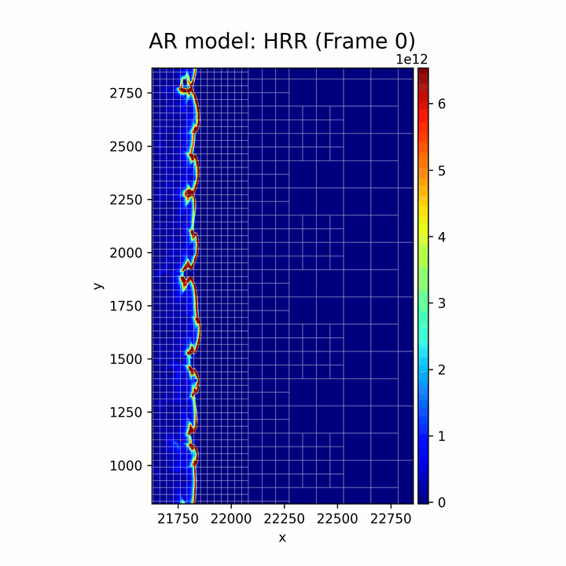</td>
    <td>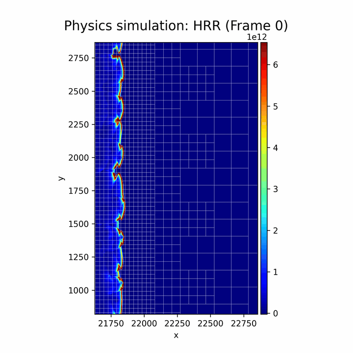</td>
  </tr>
  <tr>
    <th>Pressure</th>
    <td>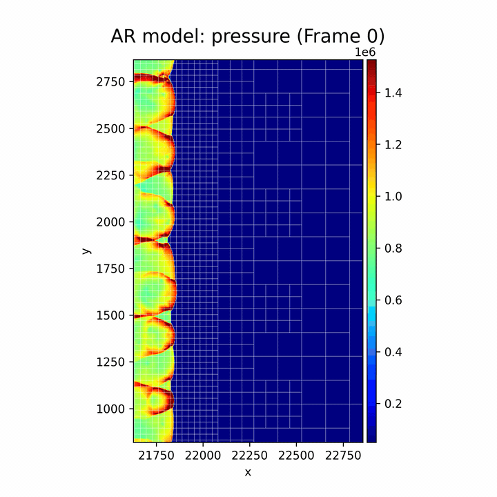</td>
    <td>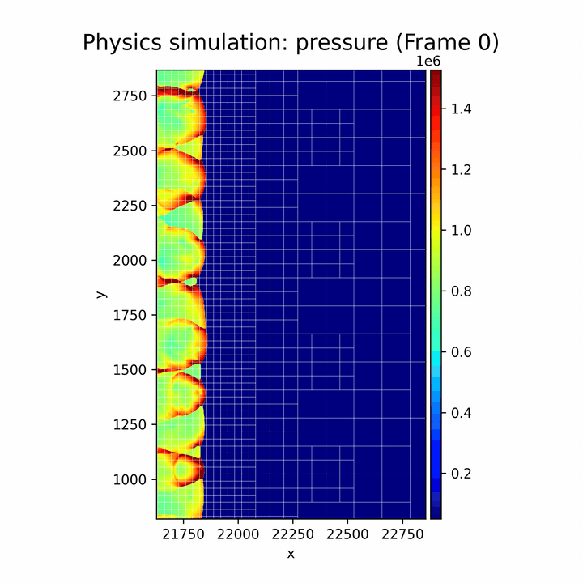</td>
  </tr>
  <tr>
    <th>Density (ρ)</th>
    <td>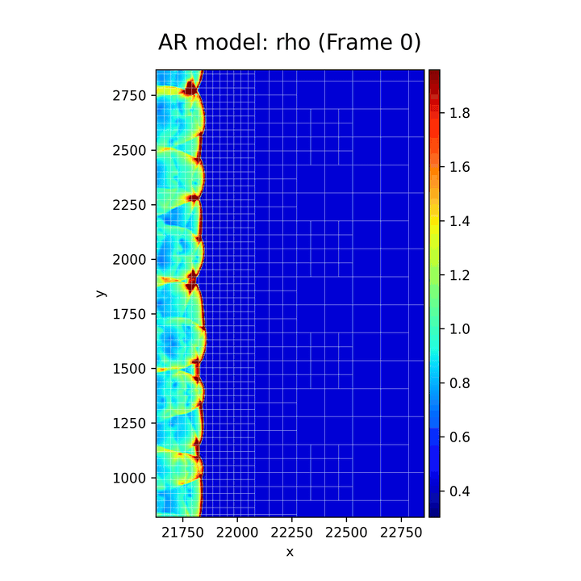</td>
    <td>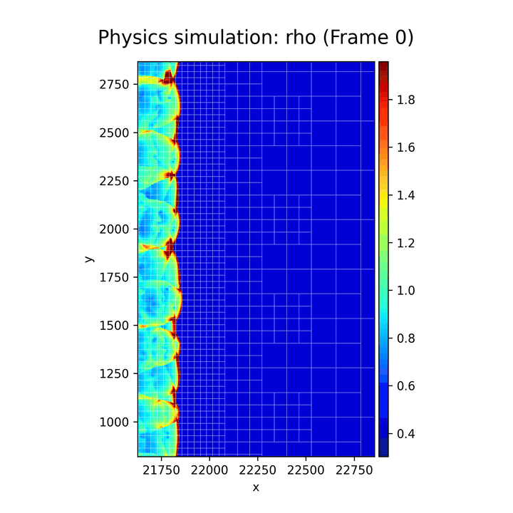</td>
  </tr>
  <tr>
    <th>Temperature</th>
    <td>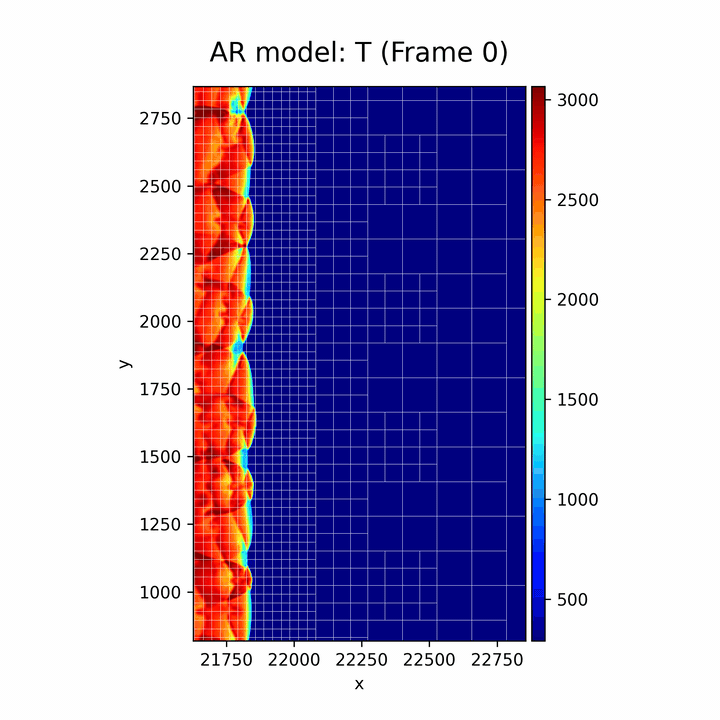</td>
    <td>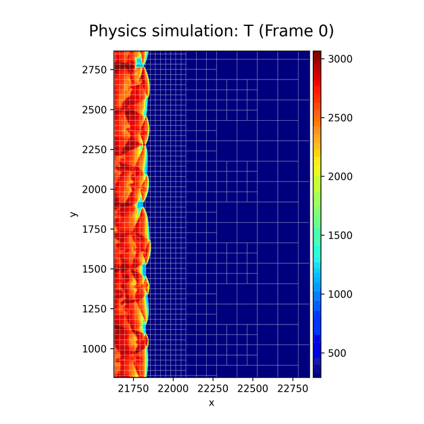</td>
  </tr>
</table>

Combustion trajectory, frame 330. Each row pairs the model's prediction with the ground truth at matching resolution.

### PLI

<table width="100%">
  <tr>
    <th width="33.33%" align="center">Ground truth</th>
    <th width="33.33%" align="center">WAMRViT (adaptive)</th>
    <th width="33.33%" align="center">WAMRViT (multi-scale)</th>
  </tr>
  <tr>
    <td>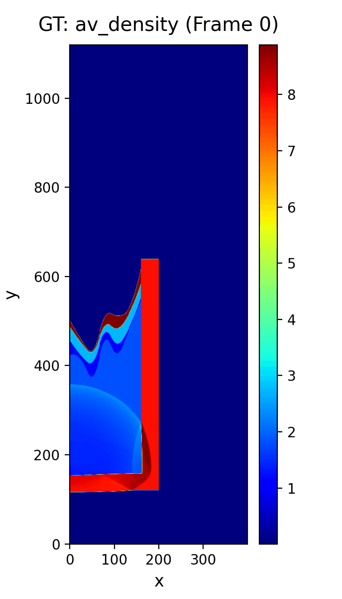</td>
    <td></td>
    <td>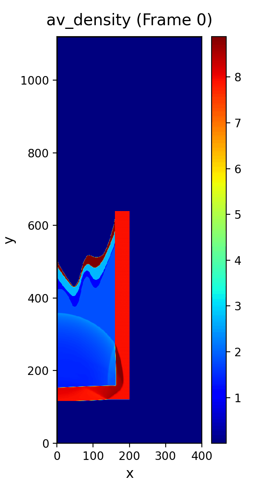</td>
  </tr>
  <tr>
    <th width="33.33%" align="center">ViT (finest)</th>
    <th width="33.33%" align="center">ViT (mid)</th>
    <th width="33.33%" align="center">SwinV2</th>
  </tr>
  <tr>
    <td></td>
    <td>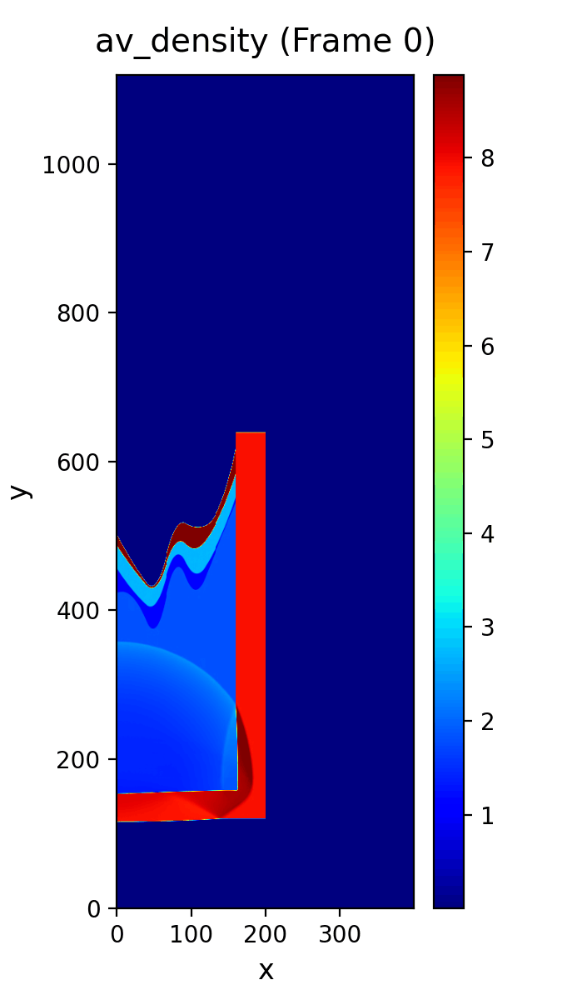</td>
    <td></td>
  </tr>
</table>

av_density, PLI trajectory 951, starting frame 20. 1120 × 400. Top row: ground truth and the two adaptive WAMRViT variants; bottom row: the three regular-grid baselines.

### TRL

<table width="100%">
  <tr><th align="center">Ground truth</th></tr>
  <tr><td>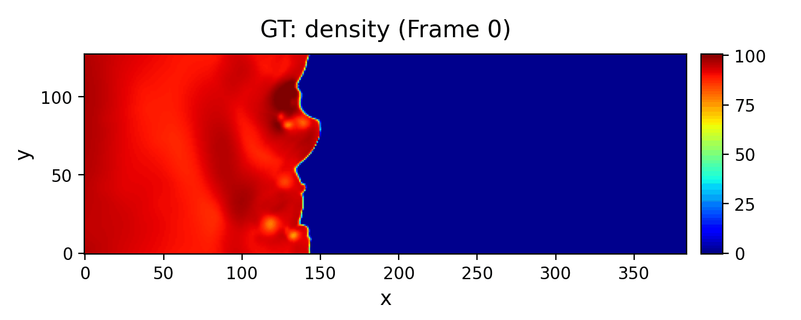</td></tr>
  <tr><th align="center">WAMRViT (adaptive)</th></tr>
  <tr><td>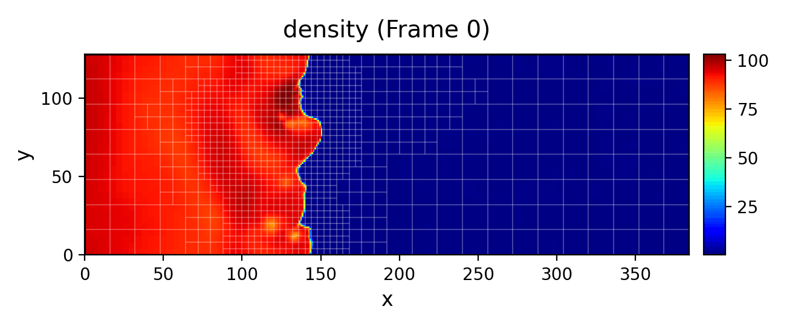</td></tr>
  <tr><th align="center">WAMRViT (multi-scale)</th></tr>
  <tr><td>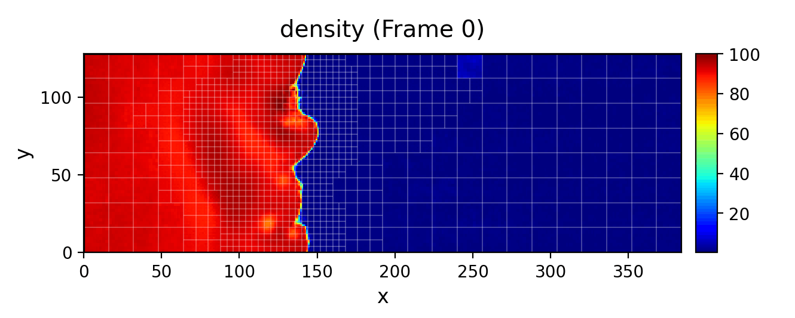</td></tr>
  <tr><th align="center">ViT (finest)</th></tr>
  <tr><td>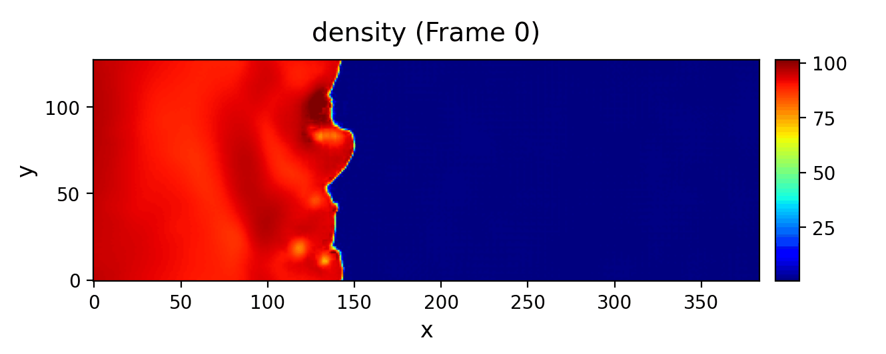</td></tr>
  <tr><th align="center">ViT (mid)</th></tr>
  <tr><td></td></tr>
  <tr><th align="center">SwinV2</th></tr>
  <tr><td></td></tr>
</table>

Density field, TRL (turbulent radiative layer) trajectory 0, frame 20. 128 × 384. The adaptive variants overlay the quadtree mesh. 

---

## Install

Python ≥ 3.12. Run from this source checkout; training uses CUDA and Ray Train/DDP.

```bash
uv sync
```

## Training

Choose a recipe from `configs/experiment/` and set your paths:

```bash
export DATA_ROOT=/path/to/data
export CHECKPOINT_ROOT=/path/to/checkpoints
export OUTPUT_ROOT=/path/to/outputs

uv run train.py +experiment=pli_adaptive_train general.run_name=pli_adaptive
```

Path templates are in `configs/env/local.yaml`; override paths/resources with Hydra. `env=local` targets one GPU; `env=hpc` targets eight. Training preserves held-out partitions but does not run a validation-loss loop. `--topo-cache` is used for reporting the results in paper.

## Inference

```bash
uv run wamrvit/rollout/rollout_adaptive.py +experiment=rollout_pli_adaptive inference.checkpoint_path=/path/to/model
```

Combined recipes use `inference.checkpoint_path_adaptive` and `inference.checkpoint_path_regular`. Keep source ground truth (GT) enabled (`file_loader.params.return_src=true`) for correct regridded evaluation. Preserve the configured held-out cohort; `--eval_full` changes the evaluation protocol.

## Nomad integration

Install the optional connector with `uv sync --extra nomad`, then serve the three published PLI checkpoints using `uv run --extra nomad nomad serve nomad.yml`. See [the integration guide](docs/nomad.md) for field layouts, typed client examples and validation status.

## Layout

`train.py`: training · `configs/`: recipes · `wamrvit/`: models, data pipelines, regridding, rollout, and visualization.

## Citation

```bibtex
@misc{zhuang2026dynamicquadtreetokenizationtransformer,
  title={Dynamic Quadtree Tokenization and Transformer for Adaptive Mesh PDE Forecasting},
  author={Yilin Zhuang and Noah Zambrano and Karthik Duraisamy},
  year={2026},
  eprint={2610.04044},
  archivePrefix={arXiv},
  primaryClass={cs.CV},
  url={https://arxiv.org/abs/2610.04044},
}
```

## Acknowledgments

This work was supported by Los Alamos National Laboratory through the project “Algorithm/Software/Hardware Co-design for High Energy Density Applications” at the University of Michigan, and by the Center for Prediction, Reasoning, and Intelligence for Multiphysics Exploration (C-PRIME), a PSAAP-IV project funded by the U.S. Department of Energy under Grant No. DE-NA0004264.

## License

WAMRViT-original code is MIT-licensed; see `LICENSE`. NeuralOperator loss attribution is retained in `wamrvit/loss.py` under the same MIT terms. The Well-derived metrics retain their BSD-3-Clause notice in the header of `wamrvit/rollout/regular_metrics.py`.
